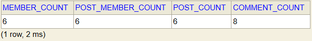
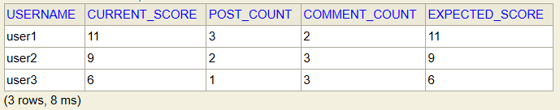
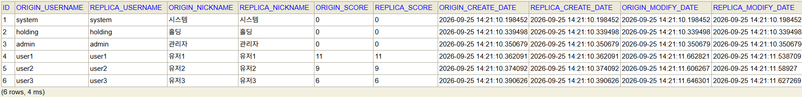
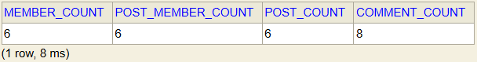
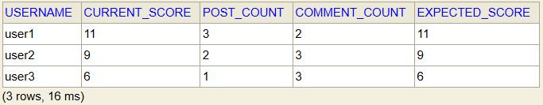
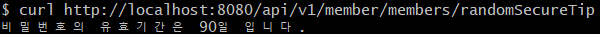

# ddd_project — 1부 미션: 회원과 글 모듈 분리

## 1. 실행 방법

### 사전준비

- **JDK**: 25
- DB: H2 (파일 기반 내장 DB, 별도 설치 불필요. 프로젝트 루트에 db_dev.mv.db 파일로 저장)
  - DB 확인: http://localhost:8080/h2-console (JDBC URL jdbc:h2:./db_dev;MODE=MySQL, 사용자명 sa, 비밀번호 없음)

 ### 실행 명령

  ```bash
  ./gradlew bootRun
  ```

## 2. 구조 설명

### 모듈 구성

`member`, `post` 두 개의 모듈(Bounded Context)로 나뉘고, 각 모듈은 다시 4개 레이어로 구성

| 레이어 | 역할 | member 모듈 | post 모듈 |
|---|---|---|---|
| `in` | 외부 진입점 (컨트롤러, 이벤트 리스너, 초기 데이터 생성) | `ApiV1MemberController`, `MemberDataInit`, `MemberEventListener` | `PostDataInit`, `PostEventListener` |
| `app` | 업무 로직 (Facade + UseCase), 트랜잭션 경계 | `MemberFacade`, `MemberJoinUseCase` | `PostFacade`, `PostWriteUseCase` |
| `domain` | 엔티티, 도메인 정책 | `Member`, `MemberPolicy` | `Post`, `PostComment`, `PostMember` |
| `out` | 영속성(Repository) | `MemberRepository` | `PostRepository`, `PostMemberRepository` |

두 모듈이 공통으로 참조하는 폴더

| 폴더 | 역할 |
|---|---|
| `shared` | 모듈 간 공유 DTO, 이벤트, `MemberApiClient` |
| `global` | 공통 인프라 — `RsData`, `DomainException`, `BaseEntity` 계열, `EventPublisher` |

### 기타 ('In' Layer)

- `Facade` : `in` 계층의 유일한 진입점. 트랜잭션 경계 관리 + `UseCase` 호출만 담당
- `UseCase` : 실제 업무 로직(가입, 글 작성 등) 수행

### 이벤트와 HTTP API를 구분한 이유

- **이벤트** : 응답 없이 해당 이벤트가 일어났다는 사실만 알면 되는 경우
  - (프로젝트) 글/댓글 작성 후 활동점수 반영, 회원 정보 변경 후 `PostMember` 복제본 갱신

- **HTTP API** : 응답을 받아야 하는 경우
  - (프로젝트) 보안 팁 조회

### 회원 복제(PostMember) 흐름

1. 회원가입(`MemberJoinUseCase.join`) 성공 → `MemberJoinedEvent` 발행
2. `PostEventListener`가 트랜잭션 커밋 후 이벤트를 받아 `PostFacade.syncMember()` 호출 → `PostMember` 신규 생성 (비밀번호는 복사 X)
3. 글/댓글 작성 → `PostCreatedEvent`/`PostCommentCreatedEvent` 발행 → `MemberEventListener`가 커밋 후 별도 트랜잭션에서 `Member.increaseActivityScore()` 호출
4. 활동점수가 바뀌면 `Member` 쪽에서 다시 `MemberModifiedEvent` 발행
5. `PostEventListener`가 이를 받아 같은 id의 `PostMember`를 갱신

## 3. 확인 결과

### 3-1. 초기 데이터 개수

```sql
SELECT
    (SELECT COUNT(*) FROM MEMBER_MEMBER)      AS member_count,
    (SELECT COUNT(*) FROM POST_MEMBER)        AS post_member_count,
    (SELECT COUNT(*) FROM POST_POST)          AS post_count,
    (SELECT COUNT(*) FROM POST_POST_COMMENT)  AS comment_count;
```

**결과:**


### 3-2. 회원별 글 수 · 댓글 수 · 활동점수 비교

```sql
SELECT
    m.username,
    m.activity_score                                                     AS current_score,
    COALESCE(p.post_count, 0)                                            AS post_count,
    COALESCE(c.comment_count, 0)                                         AS comment_count,
    COALESCE(p.post_count, 0) * 3 + COALESCE(c.comment_count, 0) * 1     AS expected_score
FROM MEMBER_MEMBER m
LEFT JOIN (
    SELECT author_id, COUNT(*) AS post_count
    FROM POST_POST
    GROUP BY author_id
) p ON p.author_id = m.id
LEFT JOIN (
    SELECT author_id, COUNT(*) AS comment_count
    FROM POST_POST_COMMENT
    GROUP BY author_id
) c ON c.author_id = m.id
WHERE m.username IN ('user1', 'user2', 'user3')
ORDER BY m.username;
```

**결과:**


### 3-3. 원본(MEMBER_MEMBER) ↔ 복제본(POST_MEMBER) 일치 확인

```sql
SELECT
    m.id,
    m.username       AS origin_username,       r.username       AS replica_username,
    m.nickname       AS origin_nickname,       r.nickname       AS replica_nickname,
    m.activity_score AS origin_score,          r.activity_score AS replica_score,
    m.create_date    AS origin_create_date,    r.create_date    AS replica_create_date,
    m.modify_date    AS origin_modify_date,    r.modify_date    AS replica_modify_date,
    r.password       AS replica_password
FROM MEMBER_MEMBER m
JOIN POST_MEMBER r ON r.id = m.id
ORDER BY m.id;
```

**결과:**



### 3-4. 재실행 시 중복 생성/활동점수 재증가 없음

**결과:**

재실행 후,

3-1 쿼리 결과:


3-2 쿼리 결과:



### 3-5. 보안 팁 API 호출 결과

> DB 조회가 아니라 **HTTP 호출**로 확인하는 항목입니다. (참고용)

```bash
curl http://localhost:8080/api/v1/member/members/randomSecureTip
```

**결과:**

